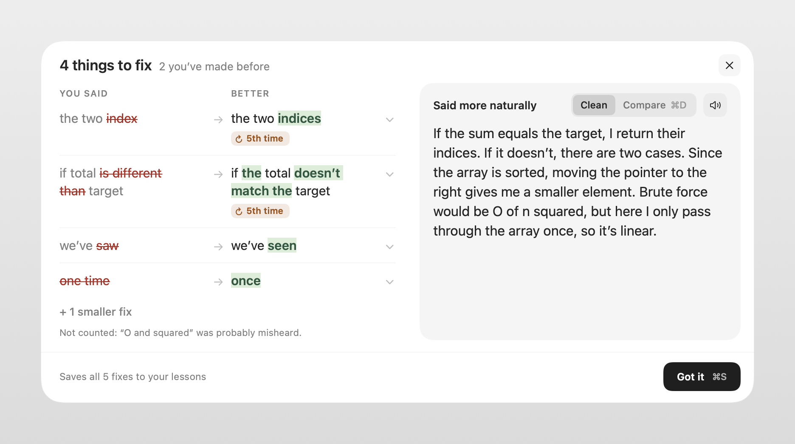
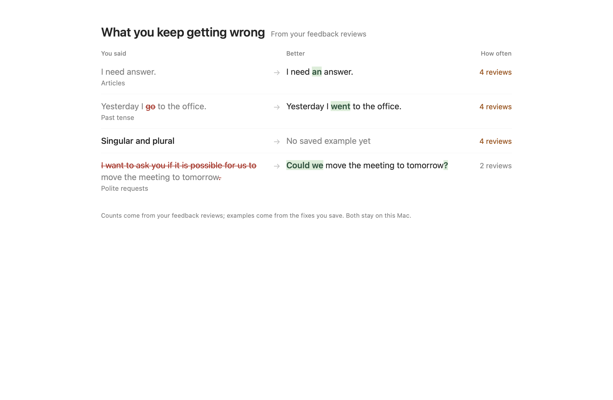

# Voxa

**Dictate on your Mac. Improve your English as you go.**

Voxa turns your voice into text in the app you’re using. Press a shortcut, speak,
and paste your words into messages, emails, notes, and more. Optional English
coaching helps you learn from what you say while you work.

## Speak instead of typing

- **Dictate from any app.** Start from the menu bar or a customizable shortcut.
  Finish or discard a recording from the compact floating bar.
- **Put your words where you need them.** Paste into the active app, copy to the
  clipboard, or copy the result later. Automatic pasting restores your previous
  clipboard when safe.
- **Finish and send.** Use a separate shortcut to paste and press Return in the
  same app—handy for sending a message.
- **Stay in your flow.** One floating panel takes you from the live waveform
  through transcription to English feedback. It appears above the Dock; drag
  the orb or feedback header to move it. Voxa remembers its position.

The recording bar uses native Liquid Glass on macOS 26 and later, with
translucent material on earlier versions. Audio cues mark recording events.
Choose **Model**, **Output**, and **Max Recording** directly in the menu bar.
Changes made during dictation apply to the next recording.

## Learn from your everyday English

Turn on **English coaching** to get feedback after dictation. Your words are
pasted as dictated; suggestions appear separately for you to review.

- **See what's wrong at a glance.** Each fix shows what you said next to a better
  way to say it, with only the changed words marked. Mistakes you repeat are flagged,
  and words that speech recognition misheard aren't counted against you.
- **Hear it said naturally.** Read your whole dictation rewritten the way a fluent
  speaker would say it, compare it sentence by sentence with ⌘D, or listen to it.
- **Make it stick.** **Got it** (⌘S) saves the fixes as lessons. Practise a saved
  lesson by speaking or typing, or revisit patterns in a one-minute review.
- **Follow your progress.** See which mistakes you keep repeating.

*Voxa’s feedback panel, shown with sample text.*
[See a practice example](assets/screenshots/english-practice.png).

Feedback opens in the same floating panel after your text is delivered. It stays
open until you close it, save it, or start a new recording; clicking elsewhere
leaves it open. **English Learning → Show Latest Feedback** reopens the latest
available review.

Enable **English Learning → English feedback** in the menu bar.

## Your Mac workspace

- **Focused Settings.** A searchable native sidebar organizes **General**, **Shortcuts**,
  **Privacy**, and **API Key**. General manages Mac permissions. Privacy contains
  nearby-text app exclusions and data details; everyday dictation and English
  Learning controls are in the menu bar.
- **What you keep getting wrong.** Open **English Learning → Lessons & Progress…**
  to see your repeated mistakes, each with your latest saved example as a You said →
  Better pair. **Saved fixes** lists everything you kept, with search, and **Practice**
  runs the one-minute review.
- **Fits your screen.** The learning window resizes, and the floating review grows
  with its contents and scrolls when needed. Views follow the system light or dark
  appearance and accessibility preferences.

*The learning window, shown with sample fixes.*
[See Settings → General](assets/screenshots/settings.png).

## Get started

You’ll need **macOS 13 or later**, an **OpenAI API key**, and an internet connection.
OpenAI API usage is billed separately. To transcribe with Mistral’s **Voxtral Small
Transcribe 3** instead, also add a **Mistral API key** and choose it under **Model** in
the menu bar. English feedback and practice checks still use OpenAI.

Voxa currently installs from source and requires Swift 6.0+ developer tools.
Follow the [installation guide](docs/usage.md#install), then:

1. Open **Settings… → API Keys** from the menu bar and save your OpenAI API key
   (and your Mistral API key if you’ll use Voxtral).
2. Open **Settings → General** to allow **Microphone**, **Accessibility**, and **Input Monitoring**.
3. Focus a text field, press **Option + F**, speak, and press it again to paste.

### Default shortcuts

| Action | Shortcut |
| --- | --- |
| Start / Stop dictation | **Option + F** |
| Finish & Send while recording in Autopaste mode | **Option + G** |
| Save every lesson in the visible feedback review and close it | **Command + S** |
| Discard a recording or close feedback without saving lessons | **Esc** |

Change these in **Settings → Shortcuts**: click a key combination, press your
replacement, and release the keys to save it. Feedback displays the configured
shortcuts.

## Your data

Audio is sent to OpenAI for transcription, or to Mistral when the Voxtral model is
selected. English coaching is off by default;
when enabled, it also sends your dictated text for feedback, with additional API
usage. Practice sends the selected lesson and your answer for feedback; spoken
answers also use transcription. Nearby-text context is off by default. When
enabled, it sends an excerpt from the active app to help feedback fit your work;
you can exclude apps in **Settings → Privacy**.

Your API keys are stored in macOS Keychain. Voxa doesn’t save an audio or full-dictation
history to disk; saved lessons, learning progress, and review timing are stored
on your Mac.
[Usage and privacy details](docs/usage.md#audio-and-data).

---

[User guide](docs/usage.md) · [Development](docs/development.md) ·
[Architecture](docs/architecture.md) · [MIT License](LICENSE)

Bundled sounds are [CC0](Sources/Voxa/Resources/Sounds/Zen/LICENSE-AUDIO).
